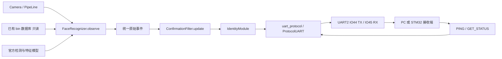

# 独立身份认证模块 V1 架构

## 目标及职责

|模块/设备|承担职责|
|---|---|
|K230D|采集图像、检测人脸、读取既有特征库、识别身份、确认观察结果、发送身份协议消息、报告自身异常|
|PC 监视器|模拟主控接收链路，校验和解析二进制帧，PING/GET_STATUS、保存与回放串口数据|
|未来 STM32F103|接收并校验协议帧，消费身份事件；后续门禁业务由另一个项目定义|

本目录没有开门决策、权限表、舵机、OLED、RFID、门锁控制或门禁状态机。连续帧确认模块仅整理视觉观察的时间一致性，输出身份信息。

## 数据流



LCD 可选预览仅显示原始人脸框、ID 和分数，不执行认证结果的门禁动作。预览文本不是串口数据源，串口从结构化事件编码。

## 文件与接口

|文件|用途|
|---|---|
|config.py|集中定义路径、阈值、USER_ID、确认/离场/cooldown、UART 和处理预算，并做启动前校验|
|vendor_face_models.py|复制官方 FaceDetApp/FaceRegistrationApp 定义，保留版权与算法，不包含官方主循环|
|ai_adapter.py|FaceRecognizer.observe(frame) 返回事件；模型初始化、只读加载数据库、归一化和相似度计算；close 释放 KPU|
|identity_result.py|将单脸匹配名称和分数转换为数字身份事件；不解析显示字符串|
|events.py|四类事件及字段校验，无硬件依赖|
|confirmation.py|ConfirmationFilter.update(event, now_ms) 返回确认事件列表，无串口操作|
|uart_protocol.py|帧编码/CRC、增量解析、消息字段编码、注入 UART 的读写；产品串口操作统一在此|
|module_runtime.py|IdentityModule.ready/observe/poll，串联确认与通信，维护诊断快照并响应主控查询|
|hardware_uart.py|真实 CanMV UART/FPIOA 的唯一构造位置，默认 UART2（IO44 TX、IO45 RX）；UART1 为备用配置；实验 UART4 必须显式开启|
|clock_adapter.py|累计 ticks_diff，把硬件回绕计数转换成单调经过时间|
|presentation.py|可选 LCD 原始观察预览，无身份授权判断|
|run_auth.py|可手动在 IDE 执行的候选入口，按官方顺序初始化与清理|
|boot_candidate.py|仅准备的自启动候选，不自动替换 /sdcard/main.py|
|pc_uart_monitor.py|真正串口/离线数据监视器，JSON 输出；PC 专用|
|tests/、run_tests.py|纯软件测试与可复现报告|
|reference_snapshot/|只读复制的板端基线源码，供审查和 AI 定义比较；不部署到板子|
|evidence/|基线哈希、部署记录、软件/硬件测试证据|

UART 接口注入真实 machine.UART 或测试适配器，AI 接口注入真实帧或测试模型。返回观察结果与独立确认接口，使 PC 测试可以跨越真实模块接口，不依赖字符串 print。

## 统一事件

每个事件都是独立字典，字段固定：

```python
{'type': 'AUTH_SUCCESS', 'user_id': 1, 'similarity': 0.90,
 'reason': 0, 'error_code': 0, 'detail': 0}
```

NO_FACE 不含身份；UNKNOWN 带原因；AUTH_SUCCESS 带数字 USER_ID 和浮点相似度；ERROR 带错误码/细节。原始 AUTH_SUCCESS 是模型匹配观察，必须经过确认过滤后才发送。AI 模块无 print、串口发送、数据库写入方法。

## 时间一致性和抑制规则

|集中参数|默认值|作用|
|---|---:|---|
|face_threshold|0.75|保留官方阈值，>= 才可匹配|
|success_frames / success_min_ms|3 / 150ms|同一 USER_ID 连续达到帧数与经过时间，两项均满足|
|unknown_frames / unknown_min_ms|3 / 150ms|同一未知原因连续确认|
|leave_frames / leave_min_ms|15 / 3000ms|实机曾因短暂漏检反复开门；持续没有人脸才确认离场|
|cooldown_ms|5000ms|相邻成功上报之间的最短间隔，跨离场保留|
|max_frame_gap_ms|1000ms|长间隔中断待确认序列，不推测缺失帧|
|error_repeat_ms|5000ms|相同错误码重复报告的最短间隔|

一次连续有人脸的阶段最多成功上报一次；同一人持续站在镜头前，即使超过 cooldown 也不会重复。成功后出现 UNKNOWN、多人脸、短暂漏检或错误都不重新允许成功；必须确认 NO_FACE。不同身份直接切换也需先确认离场，这是减少连续画面中身份抖动的 V1 输出规则。

首次 UNKNOWN 可在同一阶段升级成随后稳定的 AUTH_SUCCESS。已成功后 UNKNOWN 被抑制；离场后清除成功/未知锁存，下一阶段可重新确认。离场后若 cooldown 尚未结束，必须仍有同一稳定身份，等 cooldown 满足才发成功；人已经离开就不会迟报过去的身份。

相似度发送最后一个达到确认条件的当前帧数值，不做模型特征融合或得分优化。所有样本连续满足单帧阈值才形成同一身份序列。

## 官方算法与既有文件

完整读取了板端 main.py、main1.py、main2.py、main2_autorun.py、main2_console.py 和 AIBase/AI2D/PipeLine/Utils；同时读取电脑官方/已配置版本与增量注册/终端输出变体。基线见 evidence/baseline_manifest.json。

检测模型、人脸对齐/Umeyama、Ai2D、KPU 特征提取、归一化和 `dot/2+0.5` 公式不变；检测阈值 0.5、NMS 0.2、识别阈值 0.75 不变。512 维来自已验证的 2048 字节 float32 特征与实际模型输出；官方未使用的 feature_num=128 注释不作为维数依据。

改动是结构化匹配输出、固定长度/有限值检查和数据库只读检查。分数仅在数学端点做 [0,1] 浮点误差约束，避免量化越界，不调整阈值。多脸输出 UNKNOWN，未映射名称也输出 UNKNOWN；不挑选第一张脸上报身份。

候选生命周期顺序保留官方：UART 准备 → PipeLine.create（包含内存池整理）→ 模型/数据库初始化 → MODULE_READY → 循环。清理依次释放模型、摄像头/显示/媒体、UART。普通模型/摄像头异常发 ERROR 并结束候选，UART 故障只记本地诊断并结束，不能向坏链路递归发送错误。配置非法或 UART 构造失败发生在可靠通信之前，返回本地诊断，不承诺 wire ERROR。

软件异常可被 try/finally 清理；底层驱动死锁、断电等无法由 Python 异常处理保证恢复，须列入硬件 TODO。IDE interrupt 是调试停止行为，不能当成正常识别测试通过。

## 当前启动入口与恢复

最近保留的启动状态记录是 2026-10-08：用户选择恢复原厂桌面后，`/sdcard/main.py` 已恢复为原厂备份；原人脸启动入口保存于 `/sdcard/backup/face_autorun_main_before_desktop_20261008.py`。详见 `恢复与识别诊断_20261008.md`。此前 `exec(...main2_autorun.py...)` 是 2026-10-04 的历史入口，不能作为当前启动入口描述。

本次 2026-10-13 更新只操作电脑资料，没有读取、改写或执行板端入口；实际板端当前状态仍需在下一次硬件验收时确认。不会写 `/sdcard/main.py`、官方 main1/main2、backup、注册照片或特征文件。候选程序没有注册/更新特征库的接口，读库只使用 rb。独立候选目录不会自动改变开机执行程序，`boot_candidate.py` 只留作候选文件。

当前 UART2 配置的纯软件验证见 `TEST_REPORT_UART2_INTEGRATION_20261013.md`；历史测试范围仍以对应日期的记录为准。

## 待验证项

生产 UART2 的完整二进制身份链路、电平/线序、STM32 接收及缓冲溢出、帧间时序、长期运行、断线恢复、复位后的主控同步，以及候选程序的实机识别与 USER01 离场再进入，见 TEST_REPORT.md 的 TODO。V1 的 PING/STATUS 不包含控制采集、数据库管理、参数远程写入或开门命令。
